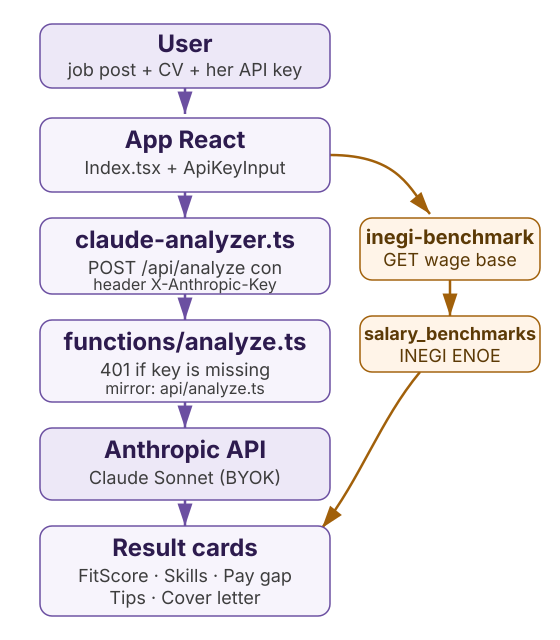

# FairHire

**English** · [Español](README.md)

AI-powered job fit and gender pay gap analyzer for women job hunting in Mexico. Paste the job post and your CV, and get back how well you fit, what you are missing, and the data to negotiate with.

**Bring your own key.** Analysis runs on your Anthropic API key (the `X-Anthropic-Key` header); the server stores no key of its own. Without one, the function answers 401.

<picture>
  <source media="(prefers-color-scheme: dark)" srcset="docs/assets/architecture-dark.svg">
  
</picture>

## What you can do

- **Score your fit**: a 0 to 100 score with a summary of why you fit (or not).
- **See what is missing**: the skills the post asks for that your CV does not show.
- **Negotiate with data**: the gender pay gap for the role, with INEGI (ENOE) figures by occupation and state.
- **Leave with a draft**: a personalized cover letter and negotiation tips based on your experience.

## How it works

1. `src/pages/Index.tsx` collects the job post, the CV and your API key (`src/components/ApiKeyInput.tsx`; it lives only in browser memory).
2. `src/lib/claude-analyzer.ts` (`analyzeJobFitWithClaude`) sends `POST /api/analyze` with the `X-Anthropic-Key` header.
3. `netlify/functions/analyze.ts` validates the input and forwards to Anthropic; without the header it answers 401 and never touches a server key. `api/analyze.ts` is the Vercel mirror.
4. The cards (`FitScoreCard`, `MissingSkillsCard`, `PayGapCard`, `SalaryTipsCard`, `CoverLetterCard`) render the analysis.
5. `netlify/functions/inegi-benchmark.ts` serves `netlify/functions/data/salary_benchmarks.json`, generated from INEGI ENOE microdata by `scripts/update-inegi-data.sh` + `process_enoe.py`.

## Minimum

- Node 22 (tested on v22.22.3) and npm.
- An Anthropic API key, entered in the UI, not in a `.env`.

```bash
git clone https://github.com/G10hdz/FairHire.git
cd FairHire
npm install
npm run dev        # frontend at http://localhost:8080
```

To exercise the function locally: `npx netlify dev --target-port 8080` (or `vercel dev` for the mirror).

## Extras

| What | Where |
|---|---|
| Main deploy | Netlify: https://fairfit-ai.netlify.app |
| Mirror deploy | Vercel: https://fairhire-sigma.vercel.app |
| Benchmarks | `GET /.netlify/functions/inegi-benchmark?ocupacion=<SINCO>&entidad=<id>` |
| Refresh ENOE data | `./scripts/update-inegi-data.sh` (needs Python 3.8+ and pandas) |
| Languages | Spanish and English, toggle in the nav (`LanguageToggle`) |

## Structure

| Path | What it is |
|---|---|
| `src/pages/Index.tsx` | Single page: input, results, language and key |
| `src/lib/claude-analyzer.ts` | Client for the analysis endpoint |
| `src/components/` | Result cards, ApiKeyInput, onboarding |
| `netlify/functions/` | Real backend: `analyze.ts` and `inegi-benchmark.ts` |
| `api/` | Function mirror for Vercel |
| `netlify/functions/data/` | `salary_benchmarks.json` generated from ENOE |
| `scripts/` | `update-inegi-data.sh`, smoke test |
| `docs/assets/` | Architecture diagrams |

## Tests

```bash
npm test           # vitest: components, page and function BYOK
npm run build      # build check
```

CI runs both plus gitleaks over the full history (`.github/workflows/ci.yml`).

## Credits

- Salary data: Encuesta Nacional de Ocupación y Empleo (ENOE), INEGI.
- Bootstrapped with Lovable; redesigned with the Positronica Labs "The Clinical Sublime" design system.
- Born at the SheBuilds hackathon.

## License

[MIT](LICENSE).
