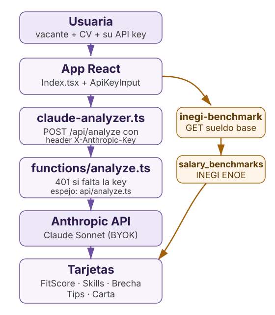

# FairHire

**Español** · [English](README.en.md)

Analizador de fit laboral y brecha salarial de género con IA, para mujeres que buscan empleo en México. Pegas la vacante y tu CV, y te devuelve qué tan bien encajas, qué te falta y con qué datos negociar.

**Trae tu propia key.** El análisis usa tu API key de Anthropic (header `X-Anthropic-Key`); el servidor no guarda ni tiene key propia. Sin key, la función responde 401.

<picture>
  <source media="(prefers-color-scheme: dark)" srcset="docs/assets/arquitectura-dark.svg">
  
</picture>

## Qué puedes hacer

- **Medir tu fit**: un score de 0 a 100 con resumen de por qué encajas (o no) en el puesto.
- **Ver qué te falta**: la lista de skills que pide la vacante y no aparecen en tu CV.
- **Negociar con datos**: brecha salarial de género para el rol, con cifras del INEGI (ENOE) por ocupación y entidad.
- **Salir con borrador**: carta de presentación personalizada y tips de negociación según tu experiencia.

## Cómo funciona

1. `src/pages/Index.tsx` recolecta la vacante, el CV y tu API key (`src/components/ApiKeyInput.tsx`, guardada solo en el navegador).
2. `src/lib/claude-analyzer.ts` (`analyzeJobFitWithClaude`) hace `POST /api/analyze` con el header `X-Anthropic-Key`.
3. `netlify/functions/analyze.ts` valida el input y reenvía a Anthropic; sin el header responde 401 y nunca toca una key del servidor. `api/analyze.ts` es el espejo para Vercel.
4. Las tarjetas (`FitScoreCard`, `MissingSkillsCard`, `PayGapCard`, `SalaryTipsCard`, `CoverLetterCard`) pintan el análisis.
5. `netlify/functions/inegi-benchmark.ts` sirve `netlify/functions/data/salary_benchmarks.json`, generado del microdato ENOE del INEGI por `scripts/update-inegi-data.sh` + `process_enoe.py`.

## Lo mínimo

- Node 22 (probado con v22.22.3) y npm.
- Una API key de Anthropic, que se escribe en la UI, no en un `.env`.

```bash
git clone https://github.com/G10hdz/FairHire.git
cd FairHire
npm install
npm run dev        # frontend en http://localhost:8080
```

Para probar la función en local: `npx netlify dev --target-port 8080` (o `vercel dev` para el espejo).

## Extras

| Qué | Dónde |
|---|---|
| Deploy principal | Netlify: https://fairfit-ai.netlify.app |
| Deploy espejo | Vercel: https://fairhire-sigma.vercel.app |
| Benchmarks | `GET /.netlify/functions/inegi-benchmark?ocupacion=<SINCO>&entidad=<id>` |
| Actualizar datos ENOE | `./scripts/update-inegi-data.sh` (pide Python 3.8+ y pandas) |
| Idiomas | Español e inglés, toggle en la barra (`LanguageToggle`) |

## Estructura

| Ruta | Qué es |
|---|---|
| `src/pages/Index.tsx` | Pantalla única: input, resultados, idioma y key |
| `src/lib/claude-analyzer.ts` | Cliente del endpoint de análisis |
| `src/components/` | Tarjetas de resultado, ApiKeyInput, onboarding |
| `netlify/functions/` | Backend real: `analyze.ts` e `inegi-benchmark.ts` |
| `api/` | Espejo de las functions para Vercel |
| `netlify/functions/data/` | `salary_benchmarks.json` generado del ENOE |
| `scripts/` | `update-inegi-data.sh`, smoke test |
| `docs/assets/` | Diagramas de arquitectura |

## Tests

```bash
npm test           # vitest: componentes, página y BYOK de las functions
npm run build      # verificación de build
```

CI corre ambos más gitleaks sobre todo el historial (`.github/workflows/ci.yml`).

## Créditos

- Datos salariales: Encuesta Nacional de Ocupación y Empleo (ENOE), INEGI.
- Bootstrapped con Lovable; rediseñado con el sistema de diseño "The Clinical Sublime" de Positronica Labs.
- Nació en el hackathon SheBuilds.

## Licencia

[MIT](LICENSE).
